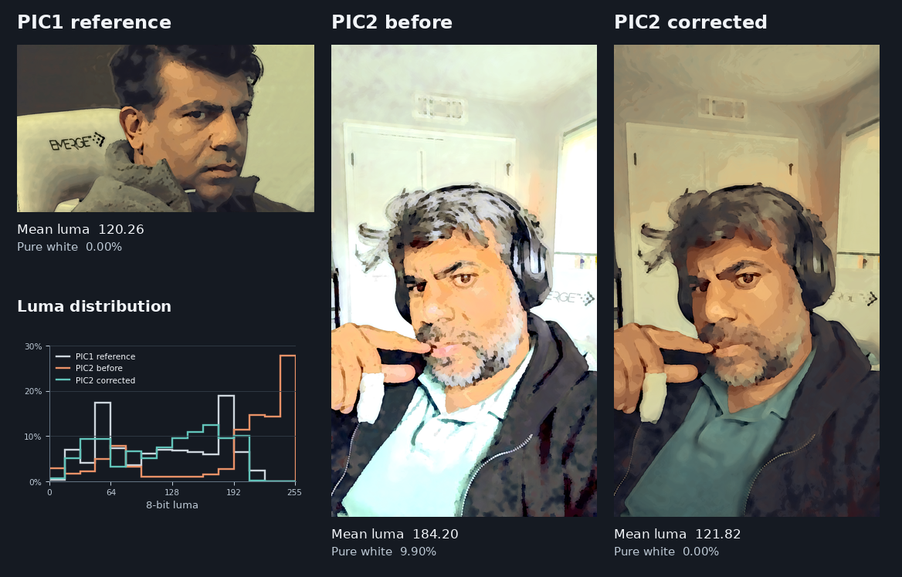

# PIC1 and PIC2 cartoon filter with frame exposure control

Profile 3 produces a 24-bit RGB BMP at the native JPEG dimensions. Both photographs use the same synthesizable filter. PIC1 is the color reference. The ZIP contains both VHDL captures, the original comparison BMPs and the full-frame verification logs.

| Input | Raster | Captured output |
|---|---|---|
| `images/PIC1.JPG` | 2048 × 1152 | `results/PIC1_filtered.bmp` |
| `images/PIC2.JPG` | 1152 × 2048 | `results/PIC2_filtered.bmp` |

The project uses the two separately supplied JPEGs. `images/PIC2_camera_original.JPG` preserves the other encoding from the supplied ZIP, which stores the photo sideways with an EXIF rotation tag. The supplied portrait already stores its pixels upright.

## Run the full VHDL simulation

In Windows CMD, open the extracted `pic2_axis` directory with Questa on `PATH`. Python 3, NumPy and Pillow handle the post-simulation checks.

```cmd
python -m pip install numpy Pillow
run.cmd 3 PIC1
run.cmd 3 PIC2
```

For NVC, run

```sh
python sim/run.py --sim nvc --profile 3 --input PIC1 --dump-input
python sim/run.py --sim nvc --profile 3 --input PIC2 --dump-input
```

Use `--sim ghdl` for GHDL. `--input` accepts a bundled stem or the path to a baseline JPEG supported by the VHDL reader. `--continuous` disables source gaps and sink stalls. The BMP writer captures the DUT's accepted AXI4-Stream beats in row-major order. The software checker runs after the file closes. Profile 2 remains available on the original 2048 × 1152 input for the 2048 × 1143 Designer2 artwork framing.

## Color transfer



| Measurement | PIC1 reference | PIC2 before | PIC2 corrected |
|---|---:|---:|---:|
| Mean luma | 120.26 | 184.20 | 121.82 |
| Pure-white pixels | 0.00% | 9.90% | 0.00% |
| Any channel at 255 | 0.000% | 23.080% | 0.037% |
| Mean red minus blue in highlights | 56.50 | -0.04 | 56.80 |
| Pixels in midtones (64 ≤ Y < 192) | 62.29% | 19.84% | 65.06% |
| Effective luma bands out of 16 | 11.28 | 9.42 | 11.75 |

The measurements use full-range 8-bit luma \(Y'=0.299R+0.587G+0.114B\). Pure white means all three channels equal 255. Highlight color is the mean of all pixels at or above each image's 90th luma percentile. The distribution plot uses 16 consecutive 16-code luma bands. The effective number of bands is \(2^H\), where \(H\) is the base-2 entropy of their occupancy. It reaches 16 when all bands contain equal numbers of pixels.

PIC2's mean luma gap from PIC1 fell from 63.94 to 1.56 codes. The previous PIC2 capture had 233,616 pure-white pixels. Over those same positions in the corrected BMP, the 10th, 50th and 90th percentile lumas are 116.4, 202.6 and 205.1.

Recalculate the statistics from the saved BMPs with `python tools/measure_color.py --json results/color_transfer.json`.

## RTL operation

`rtl/axis_scene_exposure.vhd` runs before the original camera filter and color grade. It samples one RGB pixel on an 8 × 8 grid across the frame, accumulating only accepted beats. Both supplied rasters yield 36,864 metering samples. At frame end it rounds each channel mean, calculates luma as `(5R + 9G + 2B + 8) / 16` with integer division, then sets one set of Q8 gains for the next frame. Q8 unity is 256. The two configuration cycles between frames deassert input `TREADY`.

| Metered quantity | PIC1 | PIC2 |
|---|---:|---:|
| Sampled mean RGB | (68, 67, 54) | (108, 113, 113) |
| Applied Q8 gains, R / G / B | 256 / 256 / 256 | 125 / 114 / 97 |
| Maximum shadow lift, 8-bit codes | 0 | 14 |

A mean luma up to 70 selects unity. At higher levels the exposure curve lowers the gain. The difference between mean red and blue controls a bounded warm adjustment. A small shared offset fades out as the current pixel's luma rises, preserving shadow detail. The two-register pixel datapath applies the gains and offset ahead of the nonlinear cartoon grade, while highlight variation is still available. The surface passes, tone coefficients, ink and native coordinate mapping use the existing filter arithmetic.

The still-image testbench decodes the JPEG once, streams a metering pass with `s_axis_meter_only` high at the accepted start of frame, then replays the same pixels for rendering. The first pass emits zero output beats. One filtered output frame is captured for each JPEG. The stage requires accumulators and pipeline registers beside the existing filter line memories.

For a live camera, leave `s_axis_meter_only` low. The first frame after reset uses unity and following frames use the most recently completed frame measurement. To render a still or a scene cut with its own exposure on the first emitted frame, meter and replay it as the testbench does. The metering-only flag is sampled at `TUSER` on a valid, ready beat. `TLAST` ends each row. Stalled data and frame markers travel together.

## Verification

NVC 1.23.1 simulated both attached JPEGs with source gaps and output backpressure. Each profile 3 frame produced 2,359,296 accepted pixels, one start of frame and one end of line per row. PIC1 passed through 996,686 stalled output cycles and PIC2 through 997,215. The independent model matched every RGB pixel in both captures. The continuous PIC2 run produced a byte-identical BMP. The profile 2 PIC1 compatibility run also passed its 2,340,864-pixel model comparison.

| Simulated BMP | SHA-256 of the complete file |
|---|---|
| PIC1, identical to the supplied reference | `b0d2b8050c171a1ba9f2eca988fd1d01772002d5877af8b75793873dca63c945` |
| PIC2, stalled and continuous | `347faefb319df4ea1a4e616d9bae7e79297d3196399a237a07f573408480df6a` |

`tools/check_designer.py --decoded` independently evaluates metering, integer RGB scaling, surface passes, tone grading and fine outline from the raw VHDL JPEG decode. The PIC1 run also compares the entire resulting file with `reference/PIC1_filtered.bmp`, including the BMP header. The PIC2 before-image is `reference/PIC2_filtered_before.bmp`.

`tb/tb_scene_exposure.vhd` checks cold-start unity, metering-only frame suppression, bright-to-dark and dark-to-bright frame transitions, an odd raster with a sample on the final beat, and backpressure. It passed under NVC and GHDL. GHDL 5.0.1 synthesized the full design for both native rasters and the legacy artwork profile. Its existing `ram_style` warnings refer to vendor placement hints on the window memories. Device timing and resource utilization require a target implementation.

The earlier spatial-alignment evidence is in `results/jacket_alignment.png` and `results/prior_spatial_validation/`. `results/PIC1_filtered_before.bmp` is the earlier geometry test's baseline. The current PIC1 golden is `reference/PIC1_filtered.bmp`.
